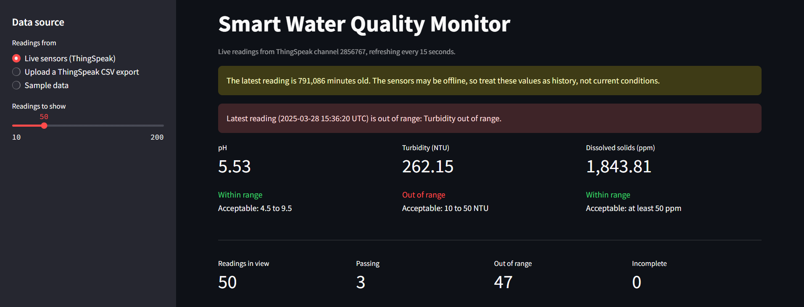
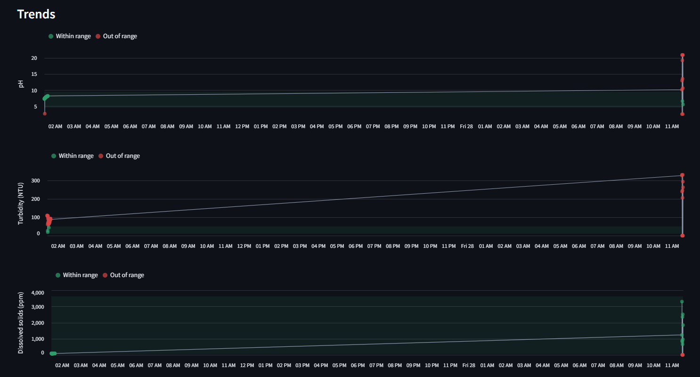
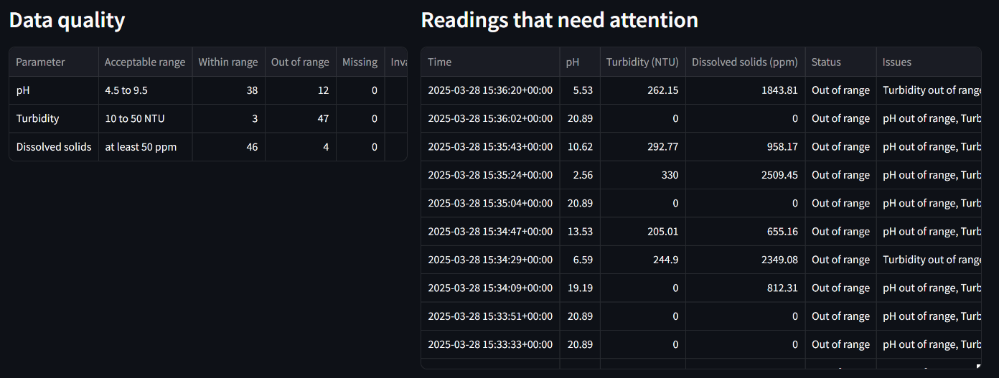

# 🐟 Smart Water Quality Prediction for Aquaculture

> Machine learning and IoT system that predicts and monitors water quality for aquaculture ponds, with a Streamlit monitoring dashboard, a Firebase web app and a Gemini-powered fish care chatbot.

Undergraduate capstone project, GITAM University.

---

## ⭐ Highlights

- **Three deep learning models** (LSTM, GRU and CNN) built in TensorFlow/Keras to predict water potability and quality
- **Key water parameters** analyzed, including pH, turbidity and total dissolved solids
- **Streamlit monitoring dashboard** that pulls live sensor readings from ThingSpeak every 15 seconds, flags out-of-range values and reports data quality
- **Firebase web app** with Realtime Database updates and Hosting
- **Fish Water Quality Chatbot** that uses the Gemini API to recommend ideal water conditions for different fish species

**Live web application:** [https://waterquality-1dcdc.web.app/](https://waterquality-1dcdc.web.app/)

---

## 🖥️ Monitoring Dashboard

### Live readings and range checks
The dashboard reads from live ThingSpeak sensors, an uploaded ThingSpeak CSV export or sample data. It checks the latest pH, turbidity and dissolved solids readings against acceptable ranges and warns when the sensor data is stale.



### Trends
Each parameter is charted over time, with out-of-range readings highlighted against the acceptable band.



### Data quality and readings that need attention
A per-parameter summary counts readings within range, out of range and missing, and a table lists every reading that needs attention, with the reason.



### What the sensor data showed
- **Turbidity was the main problem:** it was out of range in 47 of the last 50 readings.
- **Some readings were physically impossible:** several show a pH above 14, the top of the pH scale, which points to a sensor fault or calibration issue rather than real water conditions.

---

## 🎯 Project Objectives

- Predict water potability and quality from real-time sensor data
- Enable proactive management of aquaculture systems
- Develop a modular and scalable machine learning pipeline
- Provide real-time monitoring and visualization via ThingSpeak and Firebase

---

## 🛠️ Technologies Used

- **Python 3.x**
- **TensorFlow / Keras**
- **scikit-learn**
- **Pandas**, **NumPy**
- **Streamlit**
- **ThingSpeak** (IoT sensor data)
- **Firebase** (Realtime Database, Hosting)
- **Matplotlib**, **Seaborn**
- **Gemini API** (chatbot)
- **HTML / CSS / JavaScript** (chatbot and frontend)

---

## 🗂️ Project Structure

```
smart-water-quality-prediction/
├── app.py                   # Main web application
├── code/                    # Code modules for data processing and modeling
│   ├── convert.py
│   ├── labelingdata.py
│   ├── ML.py
│   ├── model_architecture.json
│   ├── model_weights.weights.h5
│   └── scaler.pkl
├── data/                    # Dataset files
│   ├── augmented_water_data.xlsx
│   ├── water_data.xlsx
│   └── water_potability.xlsx
├── web/                     # Frontend chatbot files
│   └── fish_water_quality_chatbot.html
├── templates/               # HTML templates
├── requirements.txt         # Python dependencies
└── README.md                # Documentation
```

---

## 💻 How to Run

### Step 1: Clone this repository
```bash
git clone https://github.com/Showrish/Smart-Water-Quality-Prediction-using-IoT-and-ML-.git
cd Smart-Water-Quality-Prediction-using-IoT-and-ML-
```

### Step 2: Install the required packages
```bash
pip install -r requirements.txt
```

### Step 3: Run the Streamlit app
```bash
streamlit run app.py
```

Then open `http://localhost:8501` in your browser.

---

## 📊 Example Dataset Columns

| Feature     | Description                       |
|-------------|-----------------------------------|
| pH          | Acidity or alkalinity of water    |
| Turbidity   | Cloudiness or particle level      |
| Solids      | Total dissolved solids (ppm)      |
| Potability  | 1 = safe for drinking, 0 = unsafe |

---

## 🚀 Key Features

- Predicts water potability using deep learning models (LSTM, GRU and CNN)
- Pulls live sensor readings from ThingSpeak, or works from an uploaded CSV export or sample data
- Flags readings outside acceptable ranges for pH, turbidity and dissolved solids
- Warns when sensor data is stale, so old readings aren't mistaken for current conditions
- Reports data quality per parameter and lists every reading that needs attention
- Visualizes trends in water quality data
- Real-time updates through Firebase integration
- Simple and clean web interface
- Modular structure that's easy to extend with more sensors or models
- Runs locally or in the cloud

---

## 🤖 Fish Water Quality Chatbot

The project includes a **Fish Water Quality Chatbot** built with **HTML, CSS and JavaScript**. It uses the **Gemini API** to provide ideal water parameters for different fish species, including:

- Recommended pH range
- Turbidity (NTU)
- Total dissolved solids (mg/L)

**File:** `web/fish_water_quality_chatbot.html`

### How to Use
1. Open the HTML file in any browser.
2. Enter a fish species name.
3. Click **Get Water Conditions** to see the recommended parameters.

---

## 🌊 Example Use Cases

- Automated monitoring of aquaculture ponds
- Early detection of unsuitable water conditions
- Integration into IoT-based smart aquaculture systems

---

## 👥 Collaborators

Developed as a team project by:
- **Showrish Reddy Sampath**
- **Suhash**
- **Dhanush**

Maintained by Showrish Reddy Sampath · [LinkedIn](https://linkedin.com/in/showrish-reddy-sampath-b508a22a6)
